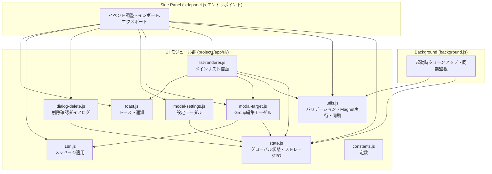
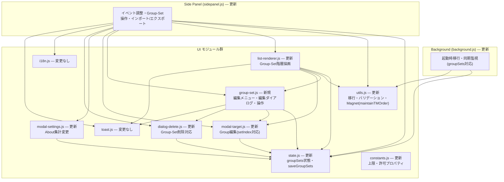
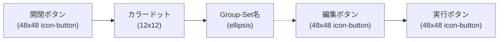
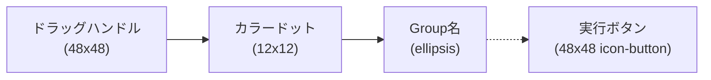
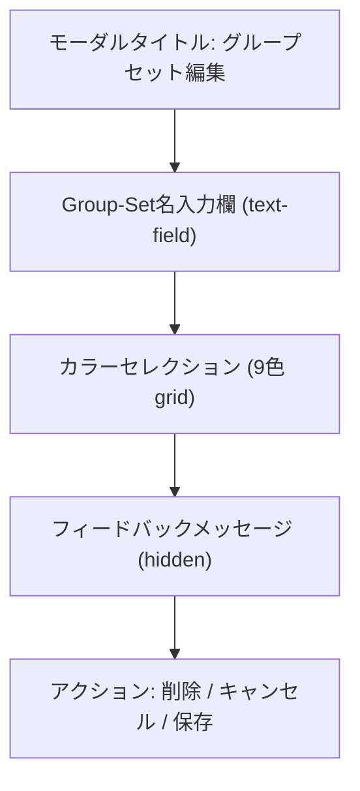
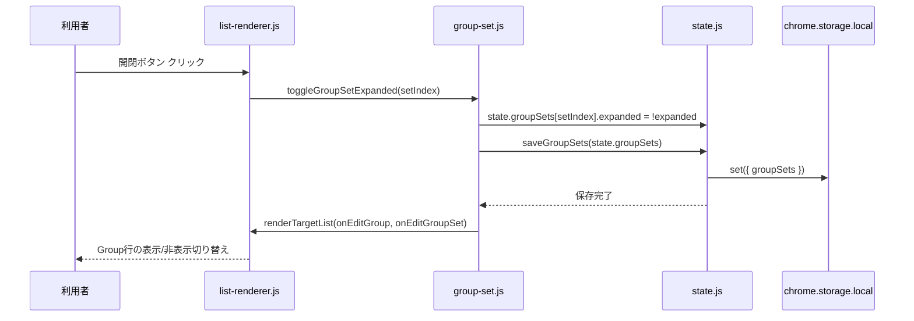
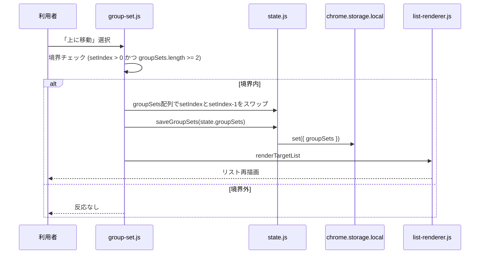
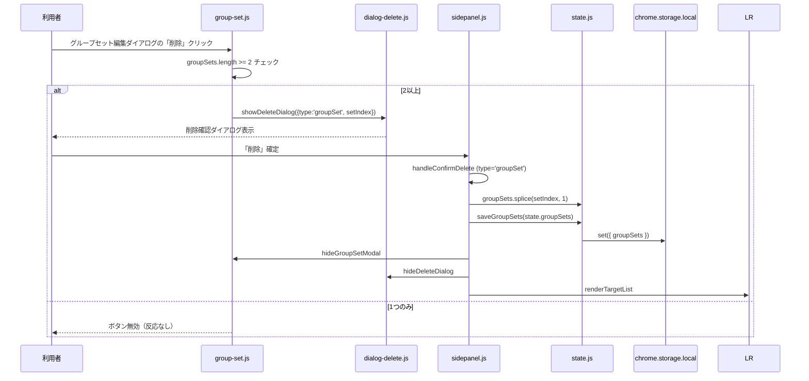
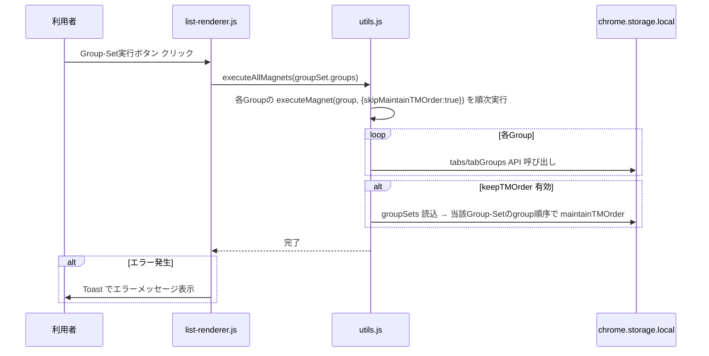

# Design Document — multi-group-sets

## Overview

本ドキュメントは、TabMagnet-Solo に「マルチグループセット（multi-group-sets）」機能を追加するための設計を定義する。既存の単一フラットなグループ集合（`targets`）を「グループセット（Group-Set）」階層で包み込み、複数のグループセットを保持・操作できるようにする。

設計の基本方針は AGENTS.md の原則に従い、既存のアーキテクチャ（モジュール分割、M3 Design、Pure Vanilla JS、ローカル完結）を尊重し、最小限の変更で要件を満たすことである。Group編集ダイアログ・削除確認ダイアログ・設定モーダル・Magnet実行ロジックの基本動作は維持し、その上にGroup-Set階層を追加する形で拡張する。

## Architecture

### 既存のモジュール構成

本拡張機能は MV3（Manifest V3）のChrome拡張機能として以下の構成を持つ。



### Group-Set階層追加後の構成

Group-Set階層を追加するため、データモデル・状態管理・描画・ダイアログを拡張する。新規モジュールとして `ui/group-set.js` を追加し、Group-Set固有の操作（編集メニュー・編集ダイアログ・移動・削除・追加・開閉トグル）を集約する。既存の `list-renderer.js` は Group-Set行とGroup行の階層描画に拡張し、Group操作の描画ロジックは既存資産を再利用する。



### 設計の基本方針

1. **階層の追加による拡張**: 既存のGroup操作（`{name, pattern, color}`）とMagnet実行ロジックはそのまま再利用し、その外側をGroup-Setで包む。
2. **移行の透明性**: Old Format（`targets`）は起動時・同期受信時・インポート時に自動的にNew Format（`groupSets`）へ移行し、利用者は意識せず利用できる。
3. **モジュールの責務分離**: Group-Set固有のUIと操作ロジックは新規モジュール `group-set.js` に集約し、`list-renderer.js` は描画に専念、`sidepanel.js` はイベント調整に専念する。

## Data Models

### New Format データ構造

```javascript
// chrome.storage.local / chrome.storage.sync に保存される構造
{
  // groupSets: Group-Set の配列（1以上20以下）
  groupSets: [
    {
      // name: Group-Set名（1文字以上100文字以下の文字列）
      name: '1stグループセット',
      // color: Chrome tabGroups API の9色または互換色キー
      color: 'grey',
      // expanded: 展開状態。true=Group表示、false=Group非表示
      expanded: true,
      // groups: Group の配列（0以上100以下）。各Groupは従来のtargetと同構造
      groups: [
        { name: 'Google', pattern: 'google.com/*', color: 'blue' },
        { name: 'Jira', pattern: ['jira.example.com/*', 'atlassian.net/*'], color: 'green' }
      ]
    }
  ],
  // settings: Old Formatと同一のプロパティ構成（変更なし）
  settings: {
    collectFromAllGroups: false,
    collapseAfterCollect: false,
    discardTabsAfterCollect: false,
    closeDuplicateTabs: false,
    keepTMOrder: false,
    syncEnabled: false
  }
}
```

### Old Format との対応関係

| Old Format | New Format | 備考 |
|------------|-----------|------|
| `targets` (配列) | `groupSets[0].groups` (配列) | 全targetsを1つのデフォルトGroup-Setに変換 |
| `targets[i].name` | `groupSets[0].groups[i].name` | そのまま保持 |
| `targets[i].pattern` | `groupSets[0].groups[i].pattern` | 文字列または配列そのまま保持 |
| `targets[i].color` | `groupSets[0].groups[i].color` | 互換色マッピングは移行時にも適用 |
| `settings` | `settings` | 構成変更なし |

### Group-Set構造の制約（constants.js に追加）

```javascript
// グループセット数の上限
export const MAX_GROUP_SETS = 20;
// 1グループセット内のグループ数の上限
export const MAX_GROUPS_PER_SET = 100;
// グループセット名の最大文字数
export const MAX_GROUP_SET_NAME_LENGTH = 100;
// Group-Set が持つことを許可されるプロパティ（過剰プロパティの検出用）
export const ALLOWED_GROUP_SET_PROPERTIES = new Set(['name', 'color', 'expanded', 'groups']);
// 新形式インポート/同期データが持つことを許可されるトップレベルプロパティ
// targets は後方互換のため維持（Old Format インポート対応）
export const ALLOWED_GROUP_SET_IMPORT_PROPERTIES = new Set(['groupSets', 'targets', 'settings']);
```

### 移行ロジック設計（utils.js に追加）

```javascript
/**
 * デフォルトのGroup-Setを生成する。
 * 新規インストール時・空状態読込時・新規追加時に使用する。
 *
 * @returns {Object} デフォルトGroup-Set（名前i18n、grey、expanded=true、空groups）
 */
export function createDefaultGroupSet() {
  // chrome.i18n.getMessage('defaultGroupSetName') で
  // ja: "(名称未設定)" / en: "(Untitled)" を取得。
  // プレースホルダは使用しない固定文字列のメッセージキーを使用する。
  const name = chrome.i18n.getMessage('defaultGroupSetName');
  return {
    name: name || '(Untitled)',
    color: 'grey',
    expanded: true,
    groups: []
  };
}

/**
 * Old Formatの targets 配列を1つのGroup-Setに変換する。
 * 移行元の全Groupの name/pattern/color を保持する。
 *
 * @param {Array} targets - Old Format の targets 配列
 * @returns {Object} 変換されたGroup-Set（デフォルト名・grey・expanded=true・groups=変換済targets）
 */
export function migrateTargetsToGroupSets(targets) {
  const groups = (targets || []).map(target => ({
    name: target.name,
    pattern: Array.isArray(target.pattern) ? [...target.pattern] : target.pattern,
    color: target.color ? getCompatibleColor(target.color) : 'grey'
  }));
  return {
    name: chrome.i18n.getMessage('defaultGroupSetName') || '(Untitled)',
    color: 'grey',
    expanded: true,
    groups
  };
}
```

移行の判定ロジックは以下の優先順位で行う（`loadState` と `syncFromCloudIfNeeded` で共通利用するヘルパー関数 `resolveGroupSets` に抽出）。

```javascript
/**
 * ローカルストレージの生データから最終的な groupSets を決定する。
 * 以下の優先順位で解決する:
 * 1. groupSets が存在し有効 → そのまま使用（移行スキップ）
 * 2. targets が存在 → 移行して groupSets 生成（呼び出し側で targets 削除）
 * 3. いずれも存在しない → デフォルトGroup-Set生成
 *
 * @param {Object} rawData - chrome.storage.local.get の結果
 * @returns {{groupSets: Array, migrated: boolean, needsCleanup: boolean}}
 */
export function resolveGroupSets(rawData) {
  if (Array.isArray(rawData.groupSets)) {
    return { groupSets: rawData.groupSets, migrated: false, needsCleanup: false };
  }
  if (Array.isArray(rawData.targets)) {
    const groupSet = migrateTargetsToGroupSets(rawData.targets);
    return { groupSets: [groupSet], migrated: true, needsCleanup: true };
  }
  return { groupSets: [createDefaultGroupSet()], migrated: true, needsCleanup: false };
}
```

### バリデーション関数設計（utils.js に追加）

既存の `validateImportData` を拡張し、New Format（`groupSets`）とOld Format（`targets`）の両方を検証できるようにする。

```javascript
/**
 * Group-Set の構造・型・上限値を検証する。
 * インポート・同期受信時に呼び出される純粋関数。
 *
 * @param {Object} groupSet - 検証対象のGroup-Set
 * @throws {Error} 構造・型・上限値が不正な場合
 */
export function validateGroupSet(groupSet) {
  if (!groupSet || typeof groupSet !== 'object' || Array.isArray(groupSet)) {
    throw new Error('Invalid group-set element');
  }
  // 4プロパティのみを持つこと（過剰プロパティは拒否）
  validateAllowedProperties(groupSet, ALLOWED_GROUP_SET_PROPERTIES, 'Invalid group-set property');
  // name: 1文字以上100文字以下の文字列
  if (typeof groupSet.name !== 'string' || groupSet.name.trim() === '' ||
      groupSet.name.length > MAX_GROUP_SET_NAME_LENGTH) {
    throw new Error('Invalid group-set name');
  }
  // color: ALL_COLORS または COLOR_COMPATIBILITY_MAP のキー
  if (typeof groupSet.color !== 'string' || groupSet.color.trim() === '' ||
      groupSet.color.length > MAX_TARGET_COLOR_LENGTH || !ALLOWED_TARGET_COLORS.has(groupSet.color)) {
    throw new Error('Invalid group-set color');
  }
  // expanded: 真偽値
  if (typeof groupSet.expanded !== 'boolean') {
    throw new Error('Invalid group-set expanded');
  }
  // groups: 配列・100以下
  if (!Array.isArray(groupSet.groups) || groupSet.groups.length > MAX_GROUPS_PER_SET) {
    throw new Error('Invalid group-set groups');
  }
  // 各Groupは従来の validateImportData と同等の検証を再利用
  for (const group of groupSet.groups) {
    validateSingleTarget(group); // 既存の target 検証ロジックを関数抽出したもの
  }
}

/**
 * groupSets 配列全体を検証する（要素数上限20含む）。
 *
 * @param {Array} groupSets - 検証対象のgroupSets配列
 * @throws {Error} 配列でない・要素数超過・各Group-Set不正の場合
 */
export function validateGroupSets(groupSets) {
  if (!Array.isArray(groupSets)) {
    throw new Error('Invalid format: groupSets must be an array');
  }
  if (groupSets.length > MAX_GROUP_SETS) {
    throw new Error('Invalid format: groupSets array exceeds limit');
  }
  for (const groupSet of groupSets) {
    validateGroupSet(groupSet);
  }
}
```

既存の `validateImportData` は `groupSets` キーと `targets` キーのいずれか（または両方）を許可するよう拡張する。`groupSets` が存在する場合は `validateGroupSets` を呼び出し、`targets` が存在する場合は従来通り `validateImportData` の targets 検証を呼び出す（後方互換）。両方存在する場合は `groupSets` を優先し `targets` は無視（移行済みデータとみなす）。

既存のtarget単体検証ロジックを `validateSingleTarget(target)` として関数抽出し、`validateImportData` と `validateGroupSet` の両方から再利用する。これによりGroupの検証ルール（name/pattern/color）が単一ソース化される。

## Components and Interfaces

### Group-Set行の構造

Group-Set行は従来のGroup行と同一のM3トークン（高さ56px、余白、タイポグラフィ）で構成し、左から右へ以下の要素を配置する。



- **開閉ボタン**: 従来のドラッグハンドル領域（48px幅）に配置。ドラッグ並べ替えは廃止し、クリックで展開/縮小をトグル。`aria-expanded` 属性で状態を伝達。展開時は下向き矢印（expand_more）、縮小時は右向き矢印（chevron_right）のSVGで視覚的に区別。
- **カラードット**: Group-Setの `color` プロパティに対応するCSSクラス（`bg-{color}`）を適用した12x12の丸。
- **Group-Set名**: `text-overflow: ellipsis` で領域幅超過時に省略記号表示。`font-weight: 500`。
- **編集ボタン**: 鉛筆アイコン（M3 symbol `edit`）。`aria-label` で対象Group-Set名を含めて伝達。
- **実行ボタン**: 従来のMagnet実行アイコン。`groups` が空の場合は `disabled`。

Group-Set行はドラッグ不可（`draggable` 属性を設定しない）。Group-Setの並べ替えは編集メニューの「上に移動/下に移動」で行う。

### Group行の構造（Group-Set内）

Group-Setが展開状態の場合、Group-Set行の直下に含まれる各Groupの行を順次表示する。Group行は従来のレイアウトを維持する。



- Group行はドラッグ可能（`draggable=true`）。ドラッグハンドルで並べ替え。並べ替えは該当Group-Set内の `groups` 配列順序のみ更新。
- Group行クリック → Group編集ダイアログ表示（従来通り）。
- Group行の実行ボタン → 該当GroupのMagnet実行（従来通り）。
- Group-Setの `groups` が空の場合、Group行の代わりに「登録されたグループがありません」の案内テキストをGroup-Set行の直下に表示（インデント付き）。

### 編集メニューダイアログ

Group-Set行の編集ボタン押下時に表示する選択肢ダイアログ。M3 Dialog（`surface-container-highest` 背景、28px角丸）スタイルで表示する。

5つの選択肢と有効/無効の制御ルール:

| 選択肢 | i18nキー | 無効条件 |
|--------|---------|---------|
| 新規グループの追加 | `gsEditMenuAddGroup` | 該当Group-Setのgroupsが100に達している |
| 表示中タブから新規グループを追加 | `gsEditMenuAddFromDomain` | 現在のタブが特殊ページの場合 |
| グループセットを編集 | `gsEditMenuEditSet` | 常に有効 |
| 上に移動 | `gsEditMenuMoveUp` | groupSetsが1つのみ、または該当セットが先頭(index 0) |
| 下に移動 | `gsEditMenuMoveDown` | groupSetsが1つのみ、または該当セットが最後尾 |

無効状態の選択肢は `disabled` 属性を設定し、フォーカス・操作を無効にする。各選択肢はリスト形式で表示し、クリックまたはEnter/Spaceで実行する。

### グループセット編集ダイアログ

Group-Setの名前と色を編集するモーダル。既存のGroup編集モーダルと同一のM3 Modalスタイル・カラーセレクション・ボタン配置を再利用する。



- **名前入力欄**: 既存の `new-name` 入力欄を再利用せず、Group-Set専用の入力欄（`#gs-edit-name`）を設ける。プレースホルダはi18nキー `gsPlaceholderName`。
- **カラーセレクション**: Group編集と同一の `renderColorOptions` ロジックを再利用（`group-set.js` から呼び出し）。9色をブラウザ別の並び順で表示。
- **削除ボタン**: 左端、`error` クラス（赤文字）。groupSetsが2以上の場合のみ有効。1つの場合は `disabled`。
- **キャンセルボタン**: 中央。
- **保存ボタン**: 右端、`primary-container` 背景。名前が空文字・空白のみの場合は保存中断してフィードバック表示。

### フッター

従来の2ボタン（「+新規グループ」「+表示中タブのグループ」）を1ボタン「+新規グループセット」に置き換える。既存の `footer-button` スタイル（48px高、24px角丸）を維持。groupSetsが上限（20）に達している場合は `disabled` を設定する。

## Impact on Existing Modules

### constants.js（更新）

- `MAX_GROUP_SETS`, `MAX_GROUPS_PER_SET`, `MAX_GROUP_SET_NAME_LENGTH` を追加。
- `ALLOWED_GROUP_SET_PROPERTIES`, `ALLOWED_GROUP_SET_IMPORT_PROPERTIES` を追加。
- 既存の `ALL_COLORS`, `COLORS_CHROME`, `COLORS_EDGE`, `COLOR_COMPATIBILITY_MAP`, `PREFIX_TM`, `SUFFIX_COLLECTING` は変更なし。

### utils.js（更新）

| 対象 | 変更内容 |
|------|---------|
| `DEFAULT_SETTINGS` | 変更なし |
| `getCompatibleColor`, `isEdge`, `matchUrl`, `isSpecialPage`, `getTimestamp`, `getExportTimestamp` | 変更なし |
| `validateImportData` | `groupSets` キーの検証を追加。`targets` の従来検証は `validateSingleTarget` に関数抽出して再利用。`ALLOWED_IMPORT_PROPERTIES` を `groupSets` 含む集合に拡張 |
| `validateSingleTarget`（新規抽出） | 既存のtarget単体検証ロジックを関数化。`validateImportData` と `validateGroupSet` から呼び出される |
| `validateGroupSet` / `validateGroupSets`（新規） | 前述のバリデーション関数 |
| `createDefaultGroupSet`（新規） | デフォルトGroup-Set生成 |
| `migrateTargetsToGroupSets`（新規） | Old→New移行 |
| `resolveGroupSets`（新規） | ローカル生データからのgroupSets解決 |
| `executeMagnet` | 変更なし（Group単位の実行ロジックは同一） |
| `executeAllMagnets` | 引数を `targets` 配列から `groups` 配列に変更は不要（既存のtargets配列=Group配列と同構造のため、`groupSet.groups` を渡せばそのまま動作）。ただし内部の `maintainTMOrder` 呼び出しを、呼び出し元のGroup-Setのgroup順序に従うよう拡張 |
| `maintainTMOrder` | `chrome.storage.local.get(['targets'])` から `chrome.storage.local.get(['groupSets'])` に変更し、全Group-Setのgroupsをフラット化して順序基準とする。引数に `groups`（オプション）を追加し、指定時はそのGroup-Setの順序を優先して整列 |
| `syncFromCloudIfNeeded` | `chrome.storage.sync.get(['settings', 'targets'])` を `['settings', 'groupSets', 'targets']` に拡張。`groupSets` 優先、`targets` は移行して反映。`syncEnabled` はローカル値を保持（従来通り） |
| `performAutoCleanup` | `chrome.storage.local.get(['targets', 'protectedGroups'])` を `['groupSets', 'protectedGroups']` に変更し、全Group-Setのgroupsをフラット化して重複クリーンアップ対象とする |
| `patternPartsCache` | 変更なし（要件22.4: キャッシュ機構維持） |

### state.js（更新）

```javascript
export const state = {
  groupSets: [],            // targets → groupSets に置き換え
  settings: { ...DEFAULT_SETTINGS },
  selectedColor: 'grey',
  // Group編集用: {setIndex, groupIndex} のペア。新規の場合 groupIndex=null
  currentEdit: { setIndex: null, groupIndex: null },
  // 削除対象: {type: 'group'|'groupSet', setIndex, groupIndex} で汎用化
  currentDelete: { type: null, setIndex: null, groupIndex: null },
  // Group-Set編集用
  currentEditSetIndex: null,
  selectedSetColor: 'grey'
};
```

| 対象 | 変更内容 |
|------|---------|
| `state.targets` | `state.groupSets` に置き換え |
| `state.currentEditIndex` | `state.currentEdit`（`{setIndex, groupIndex}`）に拡張 |
| `state.currentDeleteIndex` | `state.currentDelete`（`{type, setIndex, groupIndex}`）に拡張。Group-Set削除とGroup削除を区別 |
| `loadState` | `resolveGroupSets` を呼び出してgroupSetsを決定。移行が必要な場合は `targets` を削除して `groupSets` を保存。`settings` は従来通り |
| `saveTargets`（→`saveGroupSets`） | `state.groupSets` を保存。`syncEnabled` 時は `chrome.storage.sync` に `groupSets` と `settings` を保存（`targets` は保存しない）。従来の `saveTargets` は `saveGroupSets` にリネーム |
| `saveSettings` | 変更なし |

### list-renderer.js（更新）

`renderTargetList` を `renderTargetList(onEditGroup, onEditGroupSet)` に拡張する。従来の先頭固定「Magnet All」行を削除し、Group-Set行とGroup行の階層描画に変更する。

```javascript
/**
 * メインリスト（Group-Set階層）のレンダリング
 * @param {Function} onEditGroup - Group行クリック時のコールバック(setIndex, groupIndex)
 * @param {Function} onEditGroupSet - Group-Set編集ボタン押下時のコールバック(setIndex)
 */
export function renderTargetList(onEditGroup, onEditGroupSet) {
  const targetListEl = document.getElementById('target-list');
  targetListEl.innerHTML = '';

  state.groupSets.forEach((groupSet, setIndex) => {
    // 1. Group-Set行を生成
    const setRow = createGroupSetRow(groupSet, setIndex, onEditGroupSet);
    targetListEl.appendChild(setRow);

    // 2. 展開状態の場合、Group行を順次生成
    if (groupSet.expanded) {
      if (groupSet.groups.length === 0) {
        // 空セットの案内テキスト
        const emptyEl = createEmptyGroupSetNotice();
        targetListEl.appendChild(emptyEl);
      } else {
        groupSet.groups.forEach((group, groupIndex) => {
          const groupRow = createGroupRow(group, setIndex, groupIndex, onEditGroup);
          targetListEl.appendChild(groupRow);
        });
      }
    }
  });
}
```

- `createGroupSetRow`: Group-Set行を生成。開閉ボタン（`aria-expanded`）、カラードット、名前（ellipsis）、編集ボタン、実行ボタンを配置。実行ボタンは `groups.length === 0` で `disabled`。ドラッグ不可。
- `createGroupRow`: 従来のGroup行描画ロジックを関数抽出したもの。`data-set-index` / `data-group-index` 属性を付与。ドラッグハンドルは `group-set.js` のドラッグ並べ替えハンドラに接続。
- `createEmptyGroupSetNotice`: 「登録されたグループがありません」の案内テキスト要素。
- `handleDragOver` / `setupTouchDragList`: Group行のドラッグ並べ替えのみ対応。Group-Set行はドラッグ対象外のため、`data-static="true"` 相当の除外ロジックで Group-Set行をスキップする。ドラッグ完了時は該当Group-Set内の `groups` 配列順序のみ更新して `saveGroupSets`。
- `escapeHtml`: 変更なし（エクスポート維持）。

### modal-target.js（更新）

Group編集モーダルが「どのGroup-SetのGroupか」を認識できるよう、`showTargetModal` の引数を拡張する。

```javascript
/**
 * ターゲット追加・編集モーダルの表示
 * @param {number|null} groupIndex - 編集対象Groupのインデックス（新規の場合null）
 * @param {number} setIndex - 属するGroup-Setのインデックス
 */
export function showTargetModal(groupIndex = null, setIndex = 0) { ... }
```

- 既存の `state.currentEditIndex` 参照を `state.currentEdit.setIndex` / `state.currentEdit.groupIndex` に置き換え。
- 保存・削除時は該当Group-Setの `groups` 配列に対して操作する。
- `renderColorOptions`, `selectColor`, `addPatternInput`, `hideModalFeedback`, `showModalFeedback`, `handlePatternDragOver`, `hideTargetModal` はロジック変更なし（Groupの色・パターン編集は従来通り）。

### group-set.js（新規）

Group-Set固有のUIと操作ロジックを集約する新規モジュール。

```javascript
// エクスポートする関数群
export function showGroupSetEditMenu(setIndex);     // 編集メニューダイアログ表示
export function hideGroupSetEditMenu();             // 編集メニューダイアログ非表示
export function showGroupSetModal(setIndex);        // グループセット編集ダイアログ表示
export function hideGroupSetModal();                // グループセット編集ダイアログ非表示
export function renderGroupSetColorOptions();      // Group-Set用カラーセレクション生成
export function selectGroupSetColor(color);         // Group-Set用カラー選択状態更新
export async function toggleGroupSetExpanded(setIndex);  // 開閉トグル
export async function moveGroupSet(setIndex, direction); // 上/下に移動
export async function deleteGroupSet(setIndex);    // Group-Set削除
export async function addGroupSet();                // 新規Group-Set追加
export async function saveGroupSet(setIndex);       // Group-Set名・色保存
export function updateEditMenuButtonStates(setIndex); // 編集メニューの有効/無効制御
export function updateGroupSetDeleteButtonState();  // 削除ボタン有効/無効制御
```

各関数は `state.js` の `saveGroupSets` と `list-renderer.js` の `renderTargetList` を呼び出して状態を更新・再描画する。

### dialog-delete.js（更新）

`showDeleteDialog` / `hideDeleteDialog` を汎用化し、Group削除とGroup-Set削除を区別できるようにする。

```javascript
/**
 * 削除確認ダイアログの表示
 * @param {Object} target - 削除対象 {type: 'group'|'groupSet', setIndex, groupIndex}
 */
export function showDeleteDialog(target) {
  state.currentDelete = target;
  // 削除対象に応じてメッセージを切り替え（Group vs Group-Set）
  const dialogText = document.getElementById('delete-dialog-text');
  if (target.type === 'groupSet') {
    dialogText.textContent = chrome.i18n.getMessage('confirmDeleteGroupSet');
  } else {
    dialogText.textContent = chrome.i18n.getMessage('confirmDelete');
  }
  document.getElementById('delete-dialog-scrim').style.display = 'flex';
}
```

`state.currentDeleteIndex`（数値）から `state.currentDelete`（オブジェクト）に変更し、`handleConfirmDelete`（sidepanel.js）で `type` に応じてGroup削除/Group-Set削除を分岐する。

### modal-settings.js（更新）

- `updateAboutInfo`: `about-target-count` の集計を `state.targets.length` から「全Group-Setのgroups要素数の合計」に変更。Group-Set数の表示も検討（要件上は必須ではないがAbout情報の整合性のため）。
- `renderSettingsUI`, `showSettingsModal`, `hideSettingsModal`, `showSyncModal`, `hideSyncModal`: 変更なし。

### sidepanel.js（更新）

オーケストレーション層。主な変更点:

| 対象 | 変更内容 |
|------|---------|
| インポート/エクスポート | `state.targets` 参照を `state.groupSets` に置き換え。エクスポートは `groupSets` + `settings`（syncEnabled=false）を出力。インポートは `groupSets` キー優先、`targets` キーは移行して取り込み。追記/上書きモード対応 |
| `handleConfirmDelete` | `state.currentDelete.type` に応じてGroup削除/Group-Set削除を分岐 |
| `handleSaveTarget` | 該当Group-Setの `groups` 配列に対して保存。新規Groupは `groups` 末尾に追加 |
| `handleAddFromDomain` | 現在編集中のGroup-Set（`state.currentEdit.setIndex`）の `groups` 末尾に追加 |
| ストレージ変更リスナー | `changes.targets` 監視を `changes.groupSets` に変更。同期受信時の `targets` は移行して `groupSets` に反映 |
| フッターボタン | `add-new-btn` / `add-from-domain-btn` を `add-group-set-btn`（1ボタン）に置き換え |
| イベント設定 | `group-set.js` の各関数へのイベント接続を追加 |

### background.js（更新）

| 対象 | 変更内容 |
|------|---------|
| `chrome.storage.onChanged` リスナー | `changes.targets` 監視を `changes.groupSets` に変更。`targets` の変更通知はOld Format移行として処理して `groupSets` に反映 |
| `onStartup` / `onInstalled` | `syncFromCloudIfNeeded` と `performAutoCleanup` は utils.js 側で groupSets 対応済みのため、呼び出しは変更なし |

### i18n.js（変更なし）

`applyI18n` の仕組みは変更なし。新規HTML要素に `data-i18n` / `data-i18n-aria-label` / `data-i18n-placeholder` 属性を付与すれば自動適用される。

### toast.js（変更なし）

`showToast` はそのまま利用。Magnet実行エラー（要件8.5）やインポートエラー（要件13.6）で使用する。

## Event Flow Design

### 開閉トグルフロー



### 編集メニュー→各選択肢フロー

```mermaid
flowchart TD
    A[編集ボタン 押下] --> B[showGroupSetEditMenu]
    B --> C{選択肢選択}
    C -->|新規グループ追加| D[showTargetModal(null, setIndex)]
    C -->|表示中タブから追加| E[handleAddFromDomain → showTargetModal(null, setIndex)]
    C -->|グループセット編集| F[showGroupSetModal(setIndex)]
    C -->|上に移動| G{有効?}
    C -->|下に移動| H{有効?}
    G -->|はい| I[moveGroupSet(setIndex, -1)]
    G -->|いいえ| J[反応なし]
    H -->|はい| K[moveGroupSet(setIndex, +1)]
    H -->|いいえ| J
    I --> L[saveGroupSets → renderTargetList]
    K --> L
    D --> M[Group編集モーダル表示]
    E --> M
    F --> N[グループセット編集ダイアログ表示]
```

### 移動フロー



### 削除フロー（Group-Set）



### Group-Set実行（Magnet All）フロー



## Data Migration Design

### ローカルストレージ移行（loadState → resolveGroupSets）

```mermaid
flowchart TD
    A[loadState 呼出] --> B[chrome.storage.local.get<br/>groupSets, targets, settings]
    B --> C{groupSets が配列?}
    C -->|はい| D[groupSets をそのまま使用<br/>移行スキップ]
    C -->|いいい| E{targets が配列?}
    E -->|はい| F[migrateTargetsToGroupSets(targets)<br/>→ groupSets = [groupSet]]
    E -->|いいえ| G[createDefaultGroupSet()<br/>→ groupSets = [default]]
    F --> H[chrome.storage.local.set({ groupSets })]
    H --> I[chrome.storage.local.remove(targets)]
    D --> J[state.groupSets = groupSets]
    G --> H
    J --> K[state.settings = DEFAULT_SETTINGS + data.settings]
```

移行後は `targets` キーを `chrome.storage.local` から削除する（要件11.2）。ただし `groupSets` が既に存在する場合は移行をスキップし、`targets` が残っていても削除しない（後方互換のため、次回移行機会に処理）。

### 同期ストレージ移行（syncFromCloudIfNeeded）

`syncFromCloudIfNeeded` を拡張し、`chrome.storage.sync` から `groupSets` と `targets` の両方を取得し、`groupSets` を優先して反映する。

```mermaid
flowchart TD
    A[syncFromCloudIfNeeded] --> B[local.settings.syncEnabled?]
    B -->|false| Z[return]
    B -->|true| C[chrome.storage.sync.get<br/>settings, groupSets, targets]
    C --> D{groupSets が配列?}
    D -->|はい| E[validateGroupSets → local.groupSets = sync.groupSets]
    D -->|いいえ| F{targets が配列?}
    F -->|はい| G[migrateTargetsToGroupSets → local.groupSets = [groupSet]]
    F -->|いいえ| H[local.groupSets 削除]
    E --> I[settings 反映<br/>syncEnabled はローカル値保持]
    G --> I
    H --> I
```

同期ストレージ変更通知（`chrome.storage.onChanged`）を受信した場合も、`targets` の変更通知は Old Format 移行として処理し、`groupSets` 形式に変換してからローカルに反映する（要件12.4）。

### インポート時の移行処理

```mermaid
flowchart TD
    A[importData(data)] --> B{data.groupSets が配列?}
    B -->|はい| C[validateGroupSets(data)]
    C --> D{data.targets も存在?}
    D -->|はい| E[groupSets を優先、targets は無視]
    D -->|いいえ| F[groupSets を使用]
    B -->|いいえ| G{data.targets が配列?}
    G -->|はい| H[validateImportData(targets)<br/>→ migrateTargetsToGroupSets → [groupSet]]
    G -->|いいえ| I[エラー: 有効なデータなし]
    E --> J{importMode?}
    F --> J
    H --> J
    J -->|append| K[既存groupSets + インポートgroupSets]
    J -->|overwrite| L[インポートgroupSets で置換]
    K --> M[saveGroupSets → render → Toast成功]
    L --> M
```

エクスポートは常にNew Format（`groupSets` + `settings`、`syncEnabled=false`）を出力する（要件13.1）。

## i18n Design

### 新規メッセージキー一覧

`_locales/ja/messages.json` と `_locales/en/messages.json` の両方に以下のキーを追加する。

| キー | ja | en | 用途 |
|-----|----|----|------|
| `defaultGroupSetName` | (名称未設定) | (Untitled) | デフォルトGroup-Set名(プレースホルダなし、固定文字列) |
| `gsAddNewSet` | 新規グループセット | New Group-Set | フッター「+新規グループセット」ボタン |
| `gsEditMenuTitle` | グループセットの編集 | Edit Group-Set | 編集メニューダイアログのタイトル |
| `gsEditMenuAddGroup` | 新規グループの追加 | Add New Group | 編集メニュー選択肢1 |
| `gsEditMenuAddFromDomain` | 表示中タブから新規グループを追加 | Add Group from Active Tab | 編集メニュー選択肢2 |
| `gsEditMenuEditSet` | グループセットを編集 | Edit Group-Set | 編集メニュー選択肢3 |
| `gsEditMenuMoveUp` | 上に移動 | Move Up | 編集メニュー選択肢4 |
| `gsEditMenuMoveDown` | 下に移動 | Move Down | 編集メニュー選択肢5 |
| `gsEditModalTitle` | グループセット編集 | Edit Group-Set | グループセット編集ダイアログのタイトル |
| `gsPlaceholderName` | グループセット名 | Group-Set name | Group-Set名入力欄のプレースホルダ |
| `gsGroupColor` | グループセットの色 | Group-Set Color | カラーセレクションのラベル |
| `confirmDeleteGroupSet` | このグループセットを削除しますか？<br/>含まれるグループもすべて削除されます。 | Delete this group-set?<br/>All groups in it will also be deleted. | Group-Set削除確認メッセージ |
| `gsEmptyNotice` | 登録されたグループがありません | No groups registered | 空Group-Setの案内テキスト |
| `gsEditButton` | グループセット「$1」を編集 | Edit group-set "$1" | 編集ボタンの aria-label（プレースホルダ `$1` でセット名挿入） |
| `gsExecuteButton` | グループセット「$1」を実行 | Execute group-set "$1" | 実行ボタンの aria-label |
| `gsExpandButton` | グループセット「$1」を縮小 | Collapse group-set "$1" | 開閉ボタンの aria-label（展開時） |
| `gsCollapseButton` | グループセット「$1」を展開 | Expand group-set "$1" | 開閉ボタンの aria-label（縮小時） |
| `errorGroupSetLimit` | グループセットは20個までです | Up to 20 group-sets allowed | 上限到達時のフィードバック |
| `errorGroupNameRequired` | グループセット名を入力してください | Please enter group-set name | 空名保存時のフィードバック |
| `targetCount` | （変更）ターゲット数 → グループ数 | （変更）Group Count | About情報の集計ラベル |

既存の `magnetAll` メッセージキーは要件15.5の通り維持する（Group-Set名表示には使用しないが、互換性のため残す）。Group-Set名は `groupSet.name` プロパティを直接表示する。

## Testing Strategy

### ユニットテスト（Jest + JSDOM）

既存のテストファイル構成を踏襲し、新規ファイルを追加する。

| テストファイル | 対象 | 新規/更新 |
|--------------|------|----------|
| `tests/utils.test.js` | バリデーション（`validateGroupSets`, `validateGroupSet`, `validateSingleTarget`）、移行（`migrateTargetsToGroupSets`, `resolveGroupSets`）、`createDefaultGroupSet` | 更新 |
| `tests/ui-state.test.js` | `loadState`（移行判定）、`saveGroupSets`、`saveSettings` | 更新 |
| `tests/ui-list-renderer.test.js` | `renderTargetList`（Group-Set階層描画、カラードット、ドラッグ不可、空セット案内） | 更新 |
| `tests/ui-modal-target.test.js` | `showTargetModal`（setIndex対応）、Group保存/削除 | 更新 |
| `tests/group-set.test.js` | `toggleGroupSetExpanded`、`moveGroupSet`、`deleteGroupSet`、`addGroupSet`、`saveGroupSet`、`updateEditMenuButtonStates` | 新規 |
| `tests/ui-dialog-delete.test.js` | `showDeleteDialog`（Group/Group-Set区別）、`hideDeleteDialog` | 更新 |
| `tests/background.test.js` | ストレージ変更リスナー（groupSets/targets移行）、`performAutoCleanup` | 更新 |
| `tests/migration.test.js` | データ移行の包括的テスト（Old→New、空配列、既存、両方未定義、sync受信、targets削除検証、全Group保全） | 新規 |
| `tests/sidepanel.test.js` | インポート/エクスポート、handleConfirmDelete、handleSaveTarget、handleAddFromDomain、ストレージ変更リスナー | 更新 |

テスト戦略:
- 純粋関数（バリデーション、移行、デフォルト生成）はプロパティベーステストで幅広い入力を検証。
- UI操作ロジック（移動、削除、追加）はモック環境（JSDOM + chrome API モック）でプロパティベース＋例ベーステスト。
- 既存の全テストをNew Format対応に更新し、全テスト成功を保証（要件18.6）。

### E2Eテスト（Playwright）

| テストファイル | シナリオ | 新規/更新 |
|--------------|---------|----------|
| `tests/e2e/group-set.test.js` | 開閉操作、編集メニュー各選択肢、削除（確認ダイアログ経由）、新規セット追加、Group-Set実行 | 新規 |
| `tests/e2e/normal.test.js` | 既存シナリオのGroup-Set対応更新 | 更新 |

E2Eテストは既存の `fixtures.js`（`launchPersistentContext` で拡張をロード）を再利用する。

## File Structure

### 新規ファイル

| ファイル | 説明 |
|---------|------|
| `projects/app/ui/group-set.js` | Group-Set固有のUI・操作ロジック（編集メニュー、編集ダイアログ、移動、削除、追加、開閉トグル） |
| `tests/group-set.test.js` | group-set.js のユニットテスト |
| `tests/migration.test.js` | データ移行の包括的ユニットテスト |
| `tests/e2e/group-set.test.js` | Group-Set機能のE2Eテスト |

### 変更ファイル

| ファイル | 変更概要 |
|---------|---------|
| `projects/app/ui/constants.js` | 上限制約・許可プロパティの定数追加 |
| `projects/app/ui/utils.js` | バリデーション拡張・移行関数・`maintainTMOrder`/`syncFromCloudIfNeeded`/`performAutoCleanup` の groupSets 対応 |
| `projects/app/ui/state.js` | `state.groupSets` 化・`loadState`/`saveGroupSets` 更新・編集/削除状態の汎用化 |
| `projects/app/ui/list-renderer.js` | Group-Set階層描画・Magnet All固定行削除・Group行ドラッグの setIndex 対応 |
| `projects/app/ui/modal-target.js` | `showTargetModal(setIndex)` 対応・Group操作のGroup-Set内配列化 |
| `projects/app/ui/modal-settings.js` | `updateAboutInfo` の集計変更 |
| `projects/app/ui/dialog-delete.js` | `showDeleteDialog` の汎用化（Group/Group-Set区別） |
| `projects/app/background.js` | ストレージ変更リスナーの groupSets/targets 移行対応 |
| `projects/app/sidepanel.js` | Group-Set操作のイベント接続・インポート/エクスポートの groupSets 化・削除分岐・フッター変更 |
| `projects/app/sidepanel.html` | 編集メニューダイアログ・グループセット編集ダイアログのHTML追加・フッター1ボタン化 |
| `projects/app/_locales/ja/messages.json` | 新規メッセージキー追加 |
| `projects/app/_locales/en/messages.json` | 新規メッセージキー追加 |
| `projects/app/manifest.json` | バージョン 1.19.2 → 1.20.0 |
| `package.json` | バージョン 1.19.2 → 1.20.0 |
| `package-lock.json` | バージョン 1.19.2 → 1.20.0 |
| `README.md` | バージョンバッジ 1.19.2 → 1.20.0 |
| `tests/utils.test.js` | New Format バリデーション・移行テスト追加 |
| `tests/ui-state.test.js` | groupSets ロード・保存テスト追加 |
| `tests/ui-list-renderer.test.js` | Group-Set階層描画テスト追加 |
| `tests/ui-modal-target.test.js` | setIndex 対応テスト追加 |
| `tests/ui-dialog-delete.test.js` | Group-Set削除テスト追加 |
| `tests/background.test.js` | groupSets/targets 移行リスナーテスト追加 |
| `tests/sidepanel.test.js` | インポート/エクスポート、handleConfirmDelete、handleSaveTarget、handleAddFromDomain、ストレージ変更リスナーテスト追加 |
| `tests/e2e/normal.test.js` | Group-Set対応更新 |

## Error Handling

| ケース | 処理 |
|--------|------|
| groupSets が配列でない | `validateGroupSets` がエラーを投げ、インポート/同期受信を中断 |
| Group-Set が4プロパティ以外を持つ | `validateGroupSet` がエラーを投げる |
| Group-Set名が空・空白のみ・101文字超 | `validateGroupSet` がエラーを投げる（バリデーション時）。UI保存時は `showModalFeedback` で中断 |
| groupSets が21個 | `validateGroupSets` がエラーを投げる。UI追加時は上限到達で「+新規グループセット」ボタン無効化 |
| groups が101個 | `validateGroupSet` がエラーを投げる。UI追加時は編集メニュー「新規グループの追加」無効化 |
| color が不正値 | `validateGroupSet` / `validateSingleTarget` がエラーを投げる |
| expanded が真偽値でない | `validateGroupSet` がエラーを投げる |
| Old Format targets の不正値 | 従来の `validateImportData`（targets検証）がエラーを投げる（後方互換維持） |
| Magnet実行中のAPIエラー | `executeMagnet`/`executeAllMagnets` が例外を投げ、`showToast(errorExecutionFailed)` で通知 |
| インポートサイズ超過 | `parseImportText` がエラーを投げ、`showToast(importError)` で通知 |
| 同期受信データのバリデーション失敗 | `syncFromCloudIfNeeded` / `chrome.storage.onChanged` リスナーが `console.warn` して反映をスキップ（従来通り） |
| 移行中のストレージエラー | `try/catch` で捕捉し、コンソール警告後デフォルトGroup-Setで継続 |

## Performance Considerations

- **初期描画（要件22.1）**: 最大構成（20セット×100グループ）でも500ms以内。Group-Set行は20件固定、Group行は最大2000件。`innerHTML` の一括挿入ではなく `document.createElement` + `appendChild` で構築し、描画後に `targetListEl.innerHTML = ''` を1回だけ実行。Group行のドラッグハンドラはEvent Delegation で個別リスナ割り当てを削減し、セットアップをO(1)に抑える。
- **開閉切り替え（要件22.2）**: 100ms以内。トグル時は該当Group-SetのGroup行のみ追加/削除し、リスト全体の再描画を避ける。ただし順序一貫性のため、実装上は `renderTargetList` の部分最適化（差分更新）または全体再描画の高速化で対応する。2000件の再描画でもDOM操作は軽量なため実用的には十分高速。
- **移動操作の再描画（要件22.3）**: 200ms以内。配列スワップ後の `renderTargetList` は同上。
- **パターンマッチングキャッシュ（要件22.4）**: `patternPartsCache` は変更なし。Group-Set階層追加によってマッチング対象が増えることはなく、キャッシュ利用率は維持される。

## Correctness Properties

*A property is a characteristic or behavior that should hold true across all valid executions of a system-essentially, a formal statement about what the system should do. Properties serve as the bridge between human-readable specifications and machine-verifiable correctness guarantees.*

以下のプロパティは、prework分析とプロパティ反射（重複排除・統合）を経て導出したものである。反射の結果、3.3（縮小→展開トグル）は3.2（トグルinvolution）に統合し、2.4（カラードット反映）は2.1（描画件数・順序）に統合し、10.4/10.5（Group保存/削除）は1つのGroup操作プロパティに統合し、11.1/11.5（ローカル移行）と13.3（インポート移行）は同じ移行関数を検証するため1つの移行保全プロパティに統合した。

### Property 1: groupSets シリアライズのラウンドトリップ

*For any* 有効な `groupSets` 配列と `settings` オブジェクト、`saveGroupSets` で保存した後に `loadState` で読み込んだ結果は、元の `groupSets`（各Group-Setの `name`/`color`/`expanded`/`groups` を含む）および `settings` と等価であること。

**Validates: Requirements 1.1, 1.6, 3.4**

### Property 2: 空状態は常に有効なデフォルトgroupSetsを生成する

*For any* 空配列・未定義・null のいずれかの `groupSets` 入力状態、`resolveGroupSets` は常に1以上20以下の要素を持ち、各要素が4プロパティを持つ有効な `groupSets` 配列を返すこと。

**Validates: Requirements 1.4, 1.5**

### Property 3: 描画されたGroup-Set行は配列の件数・順序・色を反映する

*For any* 有効な `groupSets` 配列、`renderTargetList` 後に生成されるGroup-Set行の数は `groupSets.length` と一致し、表示順序は配列の順序と一致し、各Group-Set行のカラードットのCSSクラスは該当Group-Setの `color` プロパティに対応すること。

**Validates: Requirements 2.1, 2.4**

### Property 4: Group-Set行はドラッグ不可である

*For any* 有効な `groupSets` 配列、`renderTargetList` 後に生成される全てのGroup-Set行要素は `draggable` 属性が未設定または `false` であること。

**Validates: Requirements 2.3**

### Property 5: expanded トグルは対合（involution）である

*For any* Group-Setの `expanded` 状態 `e`、`toggleGroupSetExpanded` を2回連続で適用した結果の `expanded` は元の `e` と等しいこと（`toggle(toggle(e)) === e`）。

**Validates: Requirements 3.2, 3.3**

### Property 6: 空白のみのGroup-Set名は保存を拒否される

*For any* 空白文字（スペース・タブ・改行等）のみで構成される文字列 `s` をGroup-Set名として保存しようとした場合、保存は中断され、`groupSets` 配列は変更されないこと。

**Validates: Requirements 5.7**

### Property 7: Group-Set削除は件数を1減らし他を保持する

*For any* 2以上の要素を持つ `groupSets` 配列と有効な削除インデックス `i`、`deleteGroupSet(i)` 後の `groupSets.length` は元より1減少し、削除対象以外の全Group-Set（`name`/`color`/`expanded`/`groups` を含む）が保持されること。

**Validates: Requirements 6.5**

### Property 8: Group-Set移動は要素集合を保存し順序のみ変化する

*For any* 2以上の要素を持つ `groupSets` 配列と移動可能なインデックス `i`（上移動なら `i > 0`、下移動なら `i < length - 1`）、`moveGroupSet(i, direction)` 後の `groupSets` は元の要素集合（全Group-Setの同一性）を保存し、順序のみが変化すること。

**Validates: Requirements 7.5, 7.6**

### Property 9: Group-Set内のGroup保存・削除は該当セットのgroups配列を正しく更新する

*For any* 有効な `groupSets` 配列、Group-Set `setIndex` の `groups` 配列に対するGroup保存（新規追加または編集）は該当配列に変更を反映し、Group削除は該当配列からそのGroupを除去し、他のGroup-Setの `groups` 配列は変更されないこと。

**Validates: Requirements 10.4, 10.5**

### Property 10: Group-Set内のGroupドラッグ並べ替えは該当セットのgroups順序のみ更新する

*For any* 有効な `groupSets` 配列と展開状態のGroup-Set `setIndex`、そのGroup-Set内でGroupのドラッグ並べ替えを行った場合、該当Group-Setの `groups` 配列の順序が更新され、要素集合は保存され、他のGroup-Setの `groups` 配列は変更されないこと。

**Validates: Requirements 10.6**

### Property 11: データ移行は全Groupの name/pattern/color を保全する

*For any* Old Format の `targets` 配列、`migrateTargetsToGroupSets(targets)` が生成するGroup-Setの `groups` 配列は、元の `targets` と同じ要素数を持ち、各要素の `name`/`pattern`/`color` が元の値（`color` は互換マッピング適用後）と等価であること。空配列の場合は空の `groups` を持つデフォルトGroup-Setが生成されること。

**Validates: Requirements 11.1, 11.5, 13.3, 20.1**

### Property 12: 移行処理は syncEnabled フラグをローカル値で保持する

*For any* ローカルの `syncEnabled` 値 `s` と同期ストレージからの任意の移行データ、移行処理後に `state.settings.syncEnabled` は元の `s` と等しいこと。

**Validates: Requirements 12.5**

### Property 13: エクスポート・インポートのラウンドトリップ

*For any* 有効な `groupSets` 配列と `settings` オブジェクト、New Format でエクスポートしたJSONデータを上書きモードでインポートした結果の `groupSets` は、元の `groupSets` と等価であること（`syncEnabled` はエクスポート時に `false` 固定、インポート時にローカル値保持）。

**Validates: Requirements 13.1, 13.2**

### Property 14: インポートモードは追記で結合・上書きで置換する

*For any* 既存の `groupSets` 配列 `existing` と有効なインポート `groupSets` 配列 `imported`、追記モード（append）の場合は `existing` の末尾に `imported` が結合され、上書きモード（overwrite）の場合は `imported` で完全に置換されること。

**Validates: Requirements 13.4, 13.5**

### Property 15: バリデーションは全ての不正な groupSets 構造を拒否する

*For any* `groupSets` が配列でない値、要素が4プロパティ以外を持つ値、`name` が空・空白のみ・101文字超の値、`color` が有効色でない値、`expanded` が真偽値でない値、`groups` が配列でないまたは101要素超の値、`groups` 内のGroupが `validateSingleTarget` に違反する値、`groupSets` が21要素超の値のいずれかの場合、`validateGroupSets` はエラーを投げること。また、有効な Old Format（`targets` キーを持つデータ）は `validateImportData` でエラーにならないこと。

**Validates: Requirements 14.1, 14.2, 14.3, 14.4, 14.5, 14.6, 14.7, 14.8, 14.9, 1.2, 1.3**

### Property 16: Group-Set上限到達時は追加が拒否される

*For any* 20要素の `groupSets` 配列、新規Group-Setの追加は拒否され、`groupSets` 配列は20要素のままであること。

**Validates: Requirements 1.2, 9.3**
